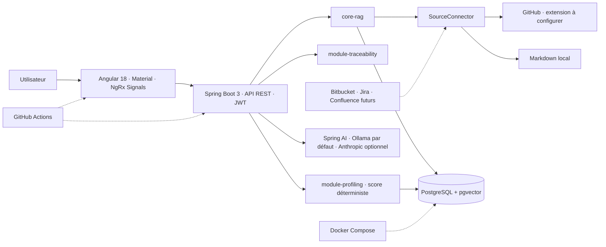

# Knowledge Profiling Platform

[](.github/workflows/ci.yml)
[](.github/workflows/ci.yml)

Monorepo de portfolio qui réunit deux démonstrations : un moteur de connaissances techniques avec citations de sources, et ConviFin, un entretien synthétique de profilage d’investisseur.

> ConviFin est une démonstration pédagogique. Ses règles de score sont illustratives, ne constituent pas un conseil financier et ne prouvent pas la conformité MiFID II. Utilisez uniquement des données synthétiques.

## Architecture



## Prérequis

- Java 21 et Maven 3.9+
- Node.js 20+ et npm
- Docker Compose
- Ollama facultatif pour activer un fournisseur LLM

## Démarrage avec Docker Compose

`docker compose up --build` démarre PostgreSQL/pgvector, l'API et le frontend. Ouvrir <http://localhost:4200> ; l'API est également publiée sur le port 8080. Les identifiants de démonstration ne sont créés que si `KPF_DEMO_USER_PASSWORD` ou `KPF_DEMO_ADMIN_PASSWORD` est configuré dans `.env`. Ollama reste optionnel : démarrer `docker compose --profile local-llm up -d ollama`, puis télécharger les modèles configurés. Sans modèle et modèle d'embeddings disponibles, les parcours LLM ne sont pas exécutables, mais le service et sa santé restent accessibles.

## Évaluations

Les questions RAG de [`eval/questions.json`](eval/questions.json) pointent vers le corpus synthétique `docs/sources/`. Les dix personas de [`eval/profiling-personas.json`](eval/profiling-personas.json) n'emploient aucune donnée personnelle. Avec le backend, PostgreSQL, les identifiants ADMIN et Ollama disponibles, lancer `make eval`. La commande réindexe les sources Markdown, juge chaque réponse RAG par Ollama (secours lexical si le juge est indisponible), contrôle les chemins des citations et exécute les entretiens synthétiques. Le résultat détaillé est écrit dans [`eval/report.md`](eval/report.md). Les taux sont des mesures de démonstration, pas une preuve de conformité ou de qualité réglementaire.

Les vérifications locales principales sont `make test` (Maven verify, tests Angular et build) et `make eval` (nécessite les services décrits ci-dessus). Docker et les tests d'intégration Testcontainers requièrent un moteur Docker actif.

## Démarrage local

1. Copier `.env.example` vers `.env` et charger les variables dans le shell si l’on souhaite activer l’authentification de démonstration. Générer une clé JWT stable avec `openssl rand -base64 32`; sans clé configurée l’application génère une clé éphémère, adaptée aux vérifications locales de santé.
2. Démarrer PostgreSQL : `docker compose up -d`.
3. Dans le dépôt, lancer `mvn -f backend/pom.xml spring-boot:run -pl app -am`. Les valeurs DB par défaut correspondent à Compose.
4. Dans `frontend/`, lancer `npm install` puis `npm start`. Le serveur de développement relaie `/api` vers `http://localhost:8080`.
5. Pour les parcours protégés, définir `KPF_DEMO_USER_PASSWORD` et/ou `KPF_DEMO_ADMIN_PASSWORD` dans l’environnement avant le premier démarrage backend. Flyway crée alors `demo-user` et `demo-admin` à partir de hash BCrypt produits au démarrage. Ouvrir `http://localhost:4200` et se connecter avec le nom correspondant et le secret configuré.

Pour lancer Ollama : `docker compose --profile local-llm up -d ollama`, puis télécharger le modèle configuré (`ollama pull llama3.2`). pgAdmin est disponible avec `docker compose --profile pgadmin up -d`. Anthropic est optionnel : construire avec `mvn -P anthropic` et configurer `ANTHROPIC_API_KEY`, puis démarrer avec le profil Spring `anthropic`.

La session JWT du navigateur est stockée dans `sessionStorage` et expire après une heure. Le MVP ne persiste aucun profil d’investisseur. Le connecteur GitHub lit un dépôt public défini par `KPF_GITHUB_REPOSITORY`, avec un jeton optionnel pour les quotas et dépôts privés. La réindexation compare les empreintes de contenu et ne recalcule les embeddings que pour les sources modifiées. Markdown simule les pages Confluence ; Jira est désactivé par défaut et décrit dans [`docs/connectors/jira.md`](docs/connectors/jira.md). Bitbucket et Confluence restent des extensions futures.

## Modules

- `backend/core-rag` : extraction PDF/Markdown/texte/code, découpage avec références de page/ligne, embeddings Ollama et recherche/citations via pgvector.
- `backend/module-traceability` : connecteurs GitHub/Markdown/Jira, liens tickets/commits/PR/fichiers/pages, indexation incrémentale et documentation Markdown générée.
- `backend/module-profiling` : extraction JSON et règles déterministes de score, couvertes par tests unitaires.
- `backend/app` : API Spring Boot, login/refresh JWT, rôles `USER`/`ADMIN`, CORS, audit sans contenu, PostgreSQL et migrations Flyway.
- `frontend` : application Angular 18 avec SignalStore NgRx par fonctionnalité, Angular Material, guards JWT/rôle et écrans Q&A, traçabilité, profilage et dashboard.

Le moteur RAG découpe les documents chargés, génère leurs embeddings avec le modèle Ollama configuré et stocke les chunks dans pgvector. Les réponses nécessitent une citation `[S1]` correspondant à un passage récupéré ; sans passage suffisamment proche ou sans citation valide, le service s’abstient avec `information non trouvée dans les sources` et `LOW`. L’upload est réservé à `ADMIN`; les questions sont accessibles à `USER` et `ADMIN`. Le score ConviFin additionne les six critères déterministes documentés dans [`docs/profiling/risk-scoring.md`](docs/profiling/risk-scoring.md) ; les catégories sont Prudent (0–34), Équilibré (35–69) et Dynamique (70–100). Le LLM n’est pas appelé pour calculer ce score.

Les routes d’authentification sont `POST /api/auth/login` et `POST /api/auth/refresh`. Les refresh tokens opaques sont stockés sous forme de SHA-256 et renouvelés à chaque usage; les JWT d’accès expirent après 15 minutes. Les actions de connexion, d’ingestion et de requête sont inscrites dans `audit_log` sans texte de requête ni contenu de document.

API RAG : `POST /api/rag/documents` accepte un fichier multipart (PDF, Markdown, texte ou code) et est réservé à `ADMIN`; `POST /api/rag/query` prend `{ "question": "...", "topK": 5 }`; `GET /api/rag/stream?question=...` renvoie un événement SSE `answer` après la validation des citations.

API de traçabilité : `POST /api/trace/reindex` (ADMIN, corps optionnel `{ "connectors": ["github", "markdown"] }`) indexe les sources modifiées ; `POST /api/trace/webhook` reçoit les événements GitHub avec `X-Hub-Signature-256` validé par `GITHUB_WEBHOOK_SECRET`. `GET /api/trace/file?path=src/...` renvoie tickets, PR et commits liés ; `POST /api/trace/impact` accepte `{ "paths": ["src/Rule.java"], "pullRequests": [7] }` ; `POST /api/trace/ask` prend `{ "question": "Pourquoi cette règle existe ?" }` et renvoie la réponse RAG ainsi que les sources reliées. Ces trois dernières routes nécessitent un token USER ou ADMIN. Les données de liens résident dans les tables `trace_entity`, `trace_link` et `trace_vector_chunk`. La génération automatique écrit sous `docs/generated/` après chaque réindexation.

ConviFin pédagogique : `POST /api/profiling/sessions` ouvre une session temporaire ; `POST /api/profiling/sessions/{id}/messages` accepte `{ "message": "..." }` et répond en SSE ; `GET /api/profiling/sessions/{id}/profile` renvoie le profil JSON ; `GET /api/profiling/sessions/{id}/profile.pdf` exporte un PDF ; `DELETE /api/profiling/sessions/{id}` efface la session ; `GET /api/profiling/dashboard` renvoie uniquement des agrégats. Les réponses restent en mémoire, liées à un pseudonyme HMAC du compte et sont supprimées au redémarrage ou sur demande. N'utiliser que les données synthétiques : ne pas saisir de nom, coordonnées, identifiants, revenus exacts ou autres données réelles. Le modèle extrait les réponses, mais le score est calculé uniquement par la grille déterministe documentée dans [`docs/profiling/risk-scoring.md`](docs/profiling/risk-scoring.md). Les résumés publics ESMA/AMF sont dans [`data/regulation`](data/regulation). Ce prototype ne fournit ni conseil financier ni validation de conformité MiFID II.

## Vérifications

```powershell
mvn -f backend/pom.xml verify
cd frontend
npm install
npm run build
npm test
```

`mvn verify` exécute les tests du score, de l'extraction structurée, des sessions et des rôles de sécurité. Les tests nécessitant PostgreSQL/Testcontainers ou un fournisseur LLM réel sont optionnels. `npm test` exécute les tests de sélecteurs/helpers d'état et de présentation accessibles.

Le frontend requiert Node.js 22.6+ pour `npm test` (le runner Node natif retire les types des helpers TypeScript) ; Angular 18 compile en mode TypeScript strict. La CI utilise Node 22.12 et exécute `npm test` puis `npm run build`.

Le test Playwright de bout en bout couvre connexion → question → source affichée. Il nécessite Chromium et un backend démo lancé sur `http://127.0.0.1:8080`, un compte ADMIN synthétique (`KPF_E2E_USERNAME`, `KPF_E2E_PASSWORD`), PostgreSQL/pgvector et Ollama avec les modèles configurés. Dans `frontend/`, installer Playwright localement sans modifier les dépendances Angular (`npm install --no-save @playwright/test@1.65.1`, puis `npx playwright install chromium`), définir `KPF_E2E_PASSWORD` et lancer `npm run test:e2e`. Le test charge un document Markdown explicitement synthétique puis vérifie la réponse et sa citation. Sans mot de passe fourni, Playwright marque le scénario ignoré.

## Variables d’environnement

| Variable | Usage |
| --- | --- |
| `KPF_JWT_SECRET` | Clé base64 de 32 octets minimum pour signer les JWT |
| `KPF_DEMO_USER_PASSWORD` | Secret synthétique optionnel de `demo-user`, haché BCrypt avant son insertion Flyway |
| `KPF_DEMO_ADMIN_PASSWORD` | Secret synthétique optionnel de `demo-admin`, haché BCrypt avant son insertion Flyway |
| `KPF_JWT_ISSUER`, `KPF_JWT_SECRET` | Émetteur et clé HMAC JWT (clé base64 de 32 octets minimum) |
| `FRONTEND_ORIGIN` | Origine autorisée pour CORS |
| `GITHUB_TOKEN` | Jeton de lecture utilisé pour ingérer le dépôt GitHub configuré |
| `KPF_GITHUB_REPOSITORY` | Dépôt à ingérer au format `owner/repository` |
| `GITHUB_API_URL` | API GitHub (peut pointer vers un serveur simulé en test) |
| `GITHUB_WEBHOOK_SECRET` | Secret partagé pour valider les webhooks GitHub |
| `JIRA_ENABLED`, `JIRA_BASE_URL`, `JIRA_EMAIL`, `JIRA_API_TOKEN`, `JIRA_PROJECT_KEYS` | Connecteur Jira optionnel, désactivé par défaut |
| `KPF_GENERATED_DOCS` | Dossier de sortie des pages de documentation générées |
| `KPF_PSEUDONYM_SECRET` | Clé HMAC facultative pour pseudonymiser sessions et audit ; clé aléatoire par processus si vide |
| `KPF_REGULATION_PATH` | Dossier local de résumés publics ESMA/AMF |
| `ANTHROPIC_API_KEY` | Fournisseur optionnel ; jamais stocké dans le dépôt |
| `DATABASE_URL`, `DATABASE_USERNAME`, `DATABASE_PASSWORD` | Connexion PostgreSQL personnalisable |
| `OLLAMA_BASE_URL`, `OLLAMA_MODEL`, `OLLAMA_EMBEDDING_MODEL` | Fournisseur de chat local et modèle d’embeddings |
| `RAG_TOP_K`, `RAG_SIMILARITY_THRESHOLD`, `EMBEDDING_DIMENSIONS` | Paramètres de recherche et taille des vecteurs pgvector |

Les mots de passe de démonstration doivent rester propres à chaque environnement ; ne pas exposer cette application comme un service public.
